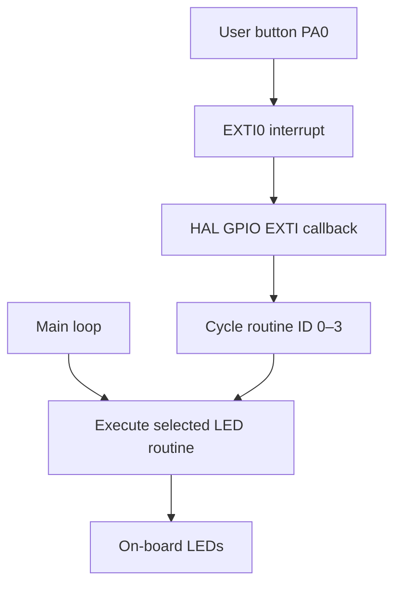

# STM32F303 LED Dance

**Interrupt-driven LED patterns on the STM32F303 Discovery board.**

`Embedded C` · `ARM Cortex-M` · `STM32 HAL` · `GPIO` · `EXTI`

An independent firmware exercise demonstrating GPIO output, interrupt-driven mode selection and hardware interaction using the STM32 HAL. Pressing the board's user button cycles through four LED routines.

  

## How it works

The application initializes HAL, clocks and peripherals. The button interrupt updates the selected routine and the main loop runs it using HAL GPIO operations.

## Build and flash

1. Install STM32CubeIDE and connect an STM32F303 Discovery board.
2. Clone and import the existing project.
3. Build the Debug configuration and flash using ST-LINK.
4. Press the user button to switch routines.

See [CubeMX configuration](01LED_Mode_Toggle.ioc), [application logic](Core/Src/main.c) and [interrupt handlers](Core/Src/stm32f3xx_it.c).

Independent application logic by [Ali Ghelichkhani](https://github.com/I-Do-CS). Vendor sources retain their original license notices.
